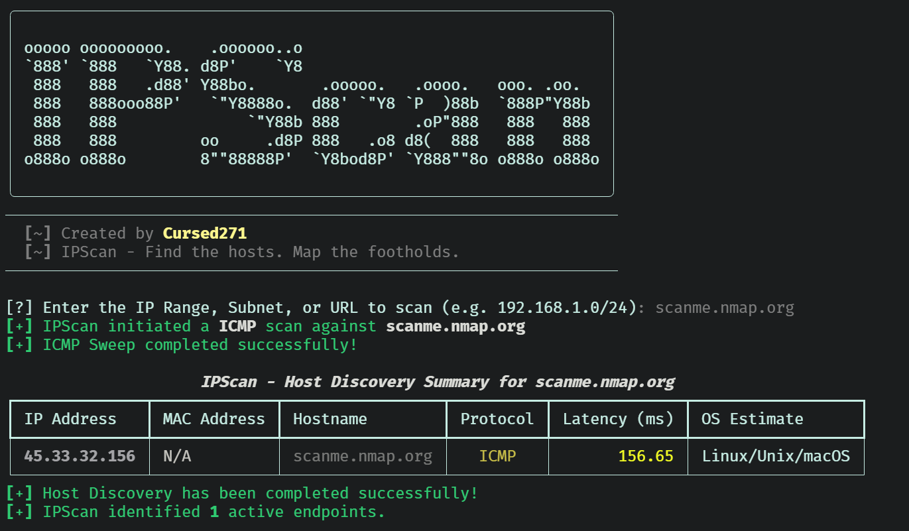

<div align="center">

  

  <h1>IPScan</h1>

  <p align="center">
    
  </p>

  <p align="center">
    
    
    
    
    <a href="./LICENSE">
      
    </a>
  </p>

  <p>Unmask Every Hidden Asset.</p>

</div>


## Overview

IPScan is a Python host-discovery utility for authorized network reconnaissance.

Version 2 provides selectable ICMP, ARP, and UDP discovery modes, reverse hostname lookups, structured terminal summaries, and optional JSON reporting.

ICMP and UDP probes use threaded execution. ARP discovery uses Scapy to send Ethernet broadcasts on the local segment.

> IPScan discovers responsive hosts. It is not a port scanner or a reliable operating-system fingerprinting engine. Nonresponsive addresses are not necessarily unused.

## Features

| Capability | What it does |
| :--- | :--- |
| ICMP discovery | Runs the operating system's ping command against each target. |
| ARP discovery | Uses Scapy to collect local IPv4 and MAC address responses. |
| UDP discovery | Sends a DNS `version.bind` TXT query in the CHAOS class to UDP port 53 and records responses. |
| Target selection | Accepts IPv4 addresses, CIDR blocks, and IPv4 ranges; also attempts hostname and URL normalization. |
| Hostname lookup | Attempts reverse DNS resolution for discovered addresses. |
| Concurrent probing | Uses configurable ICMP workers; UDP workers are capped at 50. |
| Terminal summary | Displays addresses, MAC values, hostnames, protocol, timing fields, and OS labels. |
| JSON reporting | Exports discovered-host records to a specified file. |

## Screenshots:

### Interface


## Discovery Modes

| Mode | Appropriate use | Important boundary |
| :--- | :--- | :--- |
| `icmp` | Discover hosts that respond to ping. | Firewalls and operating-system ping behavior affect results. |
| `arp` | Discover IPv4 neighbors on the local Layer 2 segment. | Not routed discovery; requires Scapy and packet access permissions. |
| `udp` | Discover hosts responding to the implemented UDP/53 DNS query. | Not a general UDP sweep or arbitrary UDP port scanner. |

Modes are selected individually. IPScan does not automatically combine all three protocols in one execution.

## Technology

| Component | Purpose |
| :--- | :--- |
| Python | Application runtime |
| Typer | Command-line options and help |
| Rich | Banner, progress indicators, and summary tables |
| Scapy | Optional ARP packet transmission and collection |
| concurrent.futures | ICMP and UDP worker pools |
| subprocess | Operating-system ping execution |
| socket | UDP probing and reverse DNS |
| ipaddress | Network expansion, range handling, and address sorting |
| json / pathlib | Report serialization and file creation |

## Installation

### Prerequisites

- Python with compatible Rich and Typer packages.
- Git for cloning the repository.
- pip for dependency installation.
- An operating-system ping utility for ICMP mode.
- DNS access if hostname resolution is needed.
- Scapy and appropriate packet access permissions for ARP mode.
- A suitable packet capture driver where required by the operating system.

Exact minimum Python and dependency versions are not declared in the supplied source. Platform compatibility must be verified in your environment.

### Installation Steps

1. Clone the repository: `git clone https://github.com/Cursed271/IPScan.git`
2. Navigate to the directory: `cd IPScan`
3. Install dependencies: `python3 -m pip install -r requirements.txt`
4. Display help: `python3 IPScan.py --help`

If `requirements.txt` is not available, install the required packages directly:

```bash
python3 -m pip install rich typer
```

For ARP discovery, also install Scapy:

```bash
python3 -m pip install scapy
```

Use an isolated Python environment. If your environment uses `python` instead of `python3`, substitute that interpreter consistently.

## Usage

Use the following examples only against explicitly authorized targets.

| Use case | Command | Description |
| :--- | :--- | :--- |
| Interactive discovery | `python3 IPScan.py` | Prompts for a target and defaults to ICMP discovery. |
| Display help | `python3 IPScan.py --help` | Lists available command-line options. |
| Single-host discovery | `python3 IPScan.py -t 192.168.1.10` | Checks one IPv4 address using ICMP. |
| Subnet discovery | `python3 IPScan.py -t 192.168.1.0/24 -m icmp` | Performs ICMP discovery across the subnet's host addresses. |
| Short IPv4 range | `python3 IPScan.py -t 192.168.1.10-20` | Checks addresses from 192.168.1.10 through 192.168.1.20, inclusive. |
| Full IPv4 range | `python3 IPScan.py -t 192.168.1.10-192.168.1.20` | Checks an explicitly defined start-to-end IPv4 range. |
| Local ARP discovery | `python3 IPScan.py -t 192.168.1.0/24 -m arp` | Discovers responding IPv4 neighbors and their MAC addresses on the local Layer 2 segment. |
| UDP DNS discovery | `python3 IPScan.py -t 192.168.1.0/24 -m udp` | Sends the implemented DNS query to UDP port 53 and records responding hosts. |
| Set ICMP workers | `python3 IPScan.py -t 192.168.1.0/24 -m icmp -n 25` | Uses 25 concurrent ICMP workers instead of the default 100. |
| Set UDP workers | `python3 IPScan.py -t 192.168.1.0/24 -m udp -n 25` | Uses 25 concurrent UDP workers; UDP concurrency never exceeds 50. |
| Set ICMP timeout | `python3 IPScan.py -t 192.168.1.0/24 -m icmp -w 2000` | Supplies a 2,000-millisecond timeout input, subject to platform-specific ping behavior. |
| Set UDP timeout | `python3 IPScan.py -t 192.168.1.0/24 -m udp -w 2000` | Sets the UDP socket timeout to two seconds. |
| Export ICMP results | `python3 IPScan.py -t 192.168.1.0/24 -m icmp -o reports/icmp.json` | Writes discovered-host records to JSON. |
| Export ARP results | `python3 IPScan.py -t 192.168.1.0/24 -m arp -o reports/arp.json` | Saves local ARP discoveries, including responding MAC addresses. |
| Export UDP results | `python3 IPScan.py -t 192.168.1.0/24 -m udp -o reports/udp.json` | Saves hosts that respond to the UDP/53 probe. |
| Combine scan settings | `python3 IPScan.py -t 192.168.1.0/24 -m icmp -n 25 -w 2000 -o reports/hosts.json` | Runs ICMP discovery with a selected worker count, timeout input, and JSON destination. |

> ARP mode requires Scapy and appropriate packet access permissions. Use a plain IPv4 address or CIDR block for ARP targets; `--threads` and `--timeout` do not change its broadcast execution or fixed two-second response window.

> JSON exports overwrite existing files at the selected destination. Results from separate scans are not automatically merged.

## Command-Line Options

| Option | Short | Default | Purpose |
| :--- | :--- | :--- | :--- |
| `--target` | `-t` | Interactive prompt | Target IPv4, CIDR, range, hostname, or URL |
| `--mode` | `-m` | `icmp` | Select `arp`, `icmp`, or `udp` |
| `--threads` | `-n` | `100` | Worker count; UDP uses at most 50 |
| `--timeout` | `-w` | `1000` | Probe timeout input in milliseconds |
| `--output` | `-o` | None | JSON destination |
| `--help` | `-h` | — | Show help |

Supply positive worker counts and timeout values. The current CLI does not enforce positive bounds.

### Timeout Behavior

- Windows ICMP passes the millisecond value to `ping -w`.
- Non-Windows ICMP passes `max(1, timeout_ms // 1000)` to `ping -W`.
- UDP converts the value to seconds for the socket timeout.
- ARP uses a fixed two-second response window.
- Reverse DNS lookups are not governed by the probe timeout.
- No independent subprocess timeout is configured.

Ping options and units differ between operating systems. The non-Windows command is not a verified universal Linux/macOS implementation.

## Output & Interpretation

### Terminal Output

<p align="center">
  
</p>

### JSON Output

JSON output contains a list of discovered-host records.

Illustrative ICMP record:

```json
[
  {
    "ip": "192.168.1.10",
    "protocol": "ICMP",
    "mac": "N/A",
    "rtt_ms": 3.42,
    "ttl": 64,
    "os": "Linux/Unix/macOS",
    "hostname": "lab-host.example"
  }
]
```

This example describes the format, not an actual scan result.

| Field | Interpretation |
| :--- | :--- |
| `ip` | Discovered address |
| `protocol` | Discovery mode or `UDP/53` |
| `mac` | ARP response MAC; otherwise `N/A` |
| `rtt_ms` | Probe duration for ICMP/UDP; display placeholder for ARP |
| `ttl` | Parsed ICMP TTL, hardcoded UDP value, or zero for ARP |
| `os` | Heuristic or mode-specific label, not confirmed OS identity |
| `hostname` | Reverse DNS result or `Unknown` |

### Measurement Limitations

- ICMP duration includes subprocess overhead; it is not the ping utility's parsed packet RTT.
- UDP duration measures elapsed socket operation time.
- ARP reports `"<1.0"` as a fixed string, not measured latency.
- UDP assigns TTL `64` and OS `Linux/Unix/macOS` without measuring either.
- ICMP OS labels depend on simple TTL thresholds.
- Missing or differently formatted ICMP TTL output produces `Unknown`.

## Known Limitations

- Version 2 is IPv4-focused. IPv6 parsing, probing, and sorting are not consistently supported.
- Hyphenated hostnames can be misinterpreted as IPv4 ranges.
- URL normalization is heuristic and does not make IPScan an HTTP scanner.
- ARP receives the original input rather than normalized addresses.
- Large networks and ranges are expanded into memory before scanning.
- No dedicated scan-rate limiter, retry strategy, or combined-mode discovery is implemented.
- Missing ping utilities and many probe errors are silently treated as no result.
- UDP replies are not validated against the expected sender or DNS transaction ID.
- UDP sockets are not explicitly closed on every exception path.
- Reverse DNS lookups can extend total execution time.
- Completion messages do not establish that every probe succeeded.
- No runtime or cross-platform test results are claimed by this documentation.

## Safe Use

- Obtain explicit authorization before scanning.
- Start with a single host or small subnet.
- Select the appropriate mode for the network segment.
- Use conservative worker counts on sensitive networks.
- Treat missing responses as inconclusive.
- Independently verify important findings.
- Protect JSON reports containing internal addresses and hostnames.
- Review the source and known limitations before relying on results.

## Troubleshooting

| Problem | What to check |
| :--- | :--- |
| No ICMP results | Ping availability, firewall policy, routing, and platform-specific flags |
| No ARP results | Local segment, Scapy installation, privileges, and packet driver |
| No UDP results | Whether the target responds to this specific UDP/53 query |
| Unexpected OS labels | TTL heuristics and hardcoded UDP metadata |
| Hostname rejected | Hyphenated names may trigger range parsing; use an authorized IPv4 address |
| Slow completion | Target count, probe behavior, and reverse DNS |
| JSON export fails | Destination permissions and filesystem availability |
| Worker error | Supply a positive `--threads` value |

## Version History

| Version | Scope |
| :--- | :--- |
| Version 1 | Interactive ICMP sweeps with a fixed 100-worker pool and terminal output |
| Version 2 | Selectable discovery modes, CLI options, host metadata, and JSON export |


## License & Usage

IPScan is distributed under the CursedSec Ownership Edict (COE).

Read [LICENSE](./LICENSE) for the applicable permissions, restrictions, contribution terms, and disclaimers. Public source availability is not a substitute for those terms.

## Feedback & Contributions

Use the repository's bug-report or feature-request template when issue submission is available.

Include the version, operating system, command, sanitized output, and reproduction steps. Never publish client scan results, credentials, sensitive infrastructure details, or evidence containing confidential data.

Check the security-reporting instructions before disclosing a vulnerability. Review the license and contribution terms before submitting modifications.

## Connect & Collaborate

<div align="center">

  <a href="https://github.com/Cursed271">
    
  </a>
  <a href="https://www.cursedsec.com/">
    
  </a>
  <a href="https://www.linkedin.com/in/cursed271/">
    
  </a>

  <p>Discover with permission. Interpret with care. Document the evidence.</p>
  <sub>CursedSec.com · Cursed271 · IPScan</sub>

</div>


